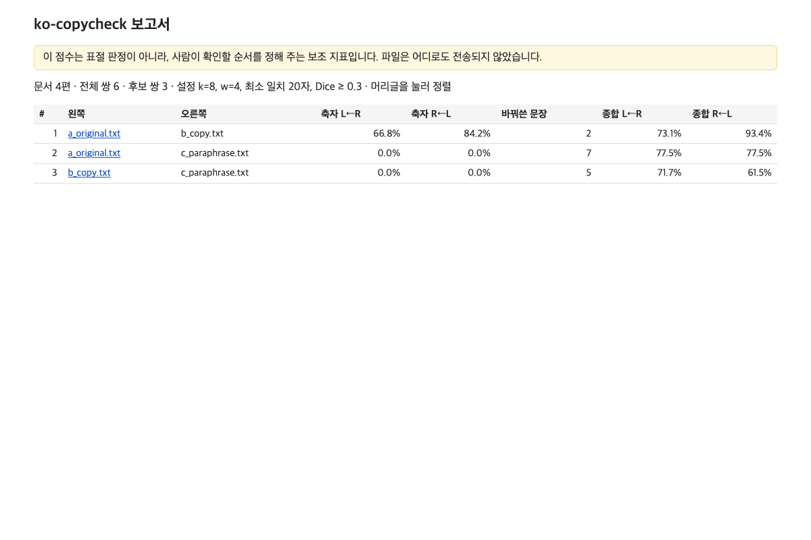
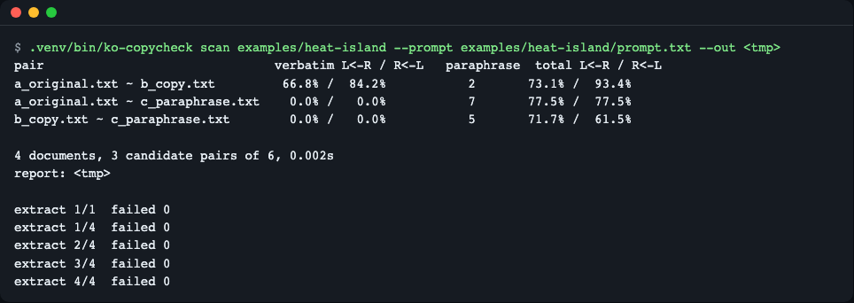
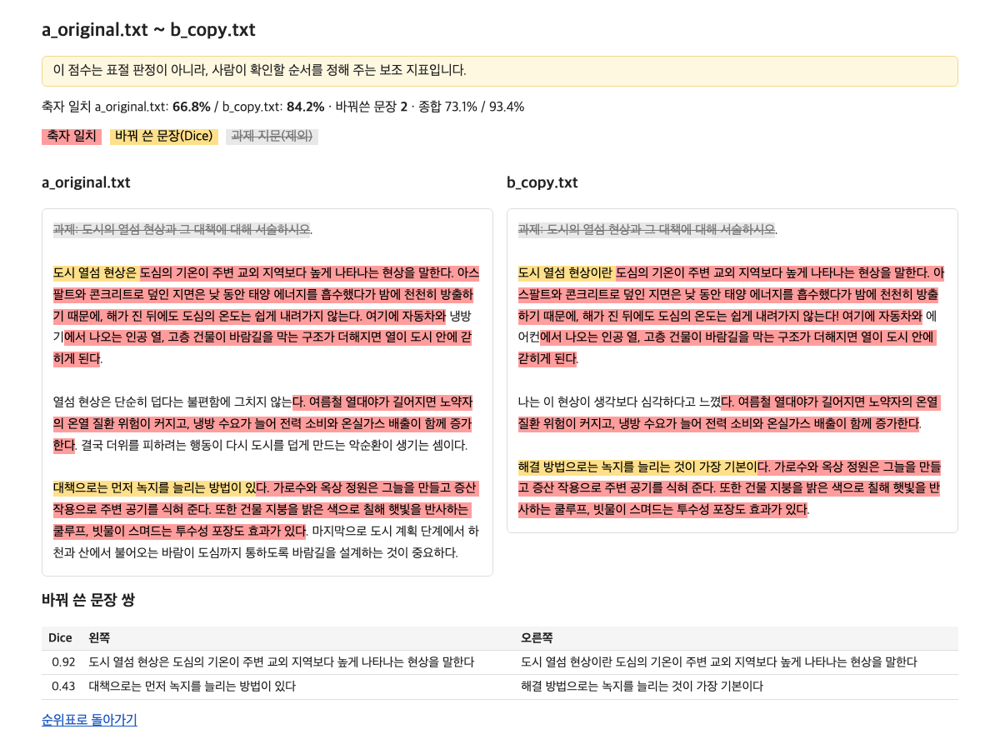
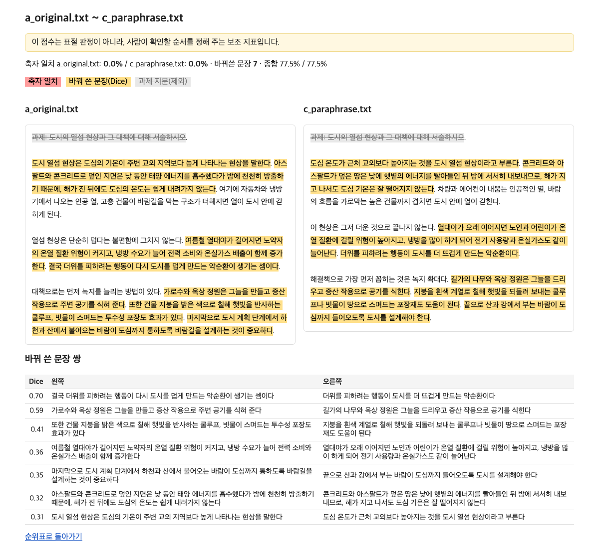
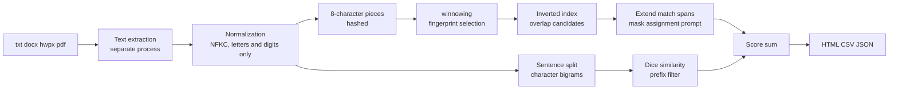

# ko-copycheck

[한국어](README.md) | **English**

An offline plagiarism checker for Korean prose submissions. Point it at a folder of txt, docx, hwpx and pdf files and it writes a ranked table of "who overlaps with whom" plus side-by-side HTML pages; nothing is uploaded. It combines winnowing (verbatim copies) with sentence character-bigram Dice similarity (paraphrases), and it ignores the assignment prompt and passages most students quote. Install: `uv tool install git+https://github.com/LeeGyeongPil/ko-copycheck`, run: `ko-copycheck scan <folder> --prompt prompt.txt`. The score is a hint for where a human should look, not a verdict.

It is an offline tool that compares a whole folder of assignment submissions against each other in one pass and produces a ranked table of **"who overlaps with whom, and by how much"**, plus an HTML report that shows suspicious pairs side by side. No file is sent anywhere.


*The index.html written by `scan`. Pairs are listed from the largest overlap down; click a name to open the side-by-side view.*

## Who it's for
- Instructors and teaching assistants who receive a class's writing assignments (tens to hundreds of essays) and want to shortlist overlapping pairs before grading
- People who cannot upload student writing to an outside service (privacy, paid quotas) and want to run everything on their own computer
- Anyone whose submissions are a mix of txt, docx, hwpx and pdf, and who found code-oriented plagiarism checkers awkward to use

This tool is **a supporting indicator that tells you in what order a human should look**. A high score does not prove plagiarism.

## Installation
Requirements: Python 3.11 or later, [uv](https://docs.astral.sh/uv/).
```bash
curl -LsSf https://astral.sh/uv/install.sh | sh      # Install uv (skip if you already have it)
uv tool install git+https://github.com/LeeGyeongPil/ko-copycheck
```
To try it once without installing, clone the repository and run it from there (the example folder used below is included).
```bash
git clone https://github.com/LeeGyeongPil/ko-copycheck && cd ko-copycheck
uv sync
```
If the `ko-copycheck` command is not found after installing (a `not on your PATH` warning), run `uv tool update-shell` and open a new terminal.

A minimal Linux container only needs `curl` and `git`. There are just two dependencies: python-docx 1.2.0 and pypdf 7.0.0.

## Quick start
`examples/heat-island/` in the repository is a short hand-written example. It contains the original (a), a nearly verbatim copy (b), a rewording of the same content (c), an unrelated essay (d), and the assignment prompt (prompt.txt).

```bash
uv run ko-copycheck scan examples/heat-island --prompt examples/heat-island/prompt.txt --out report
```
```text
pair                               verbatim L<-R / R<-L   paraphrase  total L<-R / R<-L
a_original.txt ~ b_copy.txt         66.8% /  84.2%           2       73.1% /  93.4%
a_original.txt ~ c_paraphrase.txt    0.0% /   0.0%           7       77.5% /  77.5%
b_copy.txt ~ c_paraphrase.txt        0.0% /   0.0%           5       71.7% /  61.5%

4 documents, 3 candidate pairs of 6, 0.003s
report: report/index.html
```
(The progress indicator `extract 1/4  failed 0` goes to stderr separately. `candidate pairs` is the number of pairs shown in the table, that is, pairs caught by the verbatim or paraphrase layer.)


*Terminal summary (the screenshot was taken with the installed `ko-copycheck`; only the report path on the last line shows a temporary folder). The same table is also saved to `report/index.html`, `pairs.csv` and `pairs.json`.*

How to read it:
- **verbatim L<-R**: what percentage of the left text appears verbatim in the right text (in runs of twenty or more characters). `R<-L` is the opposite direction. If a short text is contained whole in a long one, the two values differ.
- **paraphrase**: the number of sentence pairs that are similar at the sentence level even though the wording differs.
- **total**: the sum of the character ratios covered by verbatim matches and paraphrased sentences (overlapping characters are counted once).
- a and b are a copy, so the verbatim match is high; a and c have 0% verbatim match but 7 paraphrased sentences were caught. d overlaps with no other text, so it does not appear in the table (it is in the CSV and JSON with a score of 0).
- Everyone quotes the assignment prompt (`과제: 도시의 열섬 현상과 …`, "Assignment: the urban heat island phenomenon and …"), so telling the tool about it with `--prompt` removes it from the score calculation.

Open one suspicious pair and the overlapping parts are marked in color.


*a_original (left) and b_copy (right). Red shading is an exact match, yellow is a paraphrased sentence, and gray strikethrough is the assignment prompt (excluded).*


*a_original and c_paraphrase. Even when the characters are almost all different, sentences are lightly marked at the sentence level. Hover to see the Dice value.*

## Usage
| Command / option | What it does | Example |
|---|---|---|
| `scan <folder>` | Compares every pair of files in the folder and writes the report | `ko-copycheck scan submissions --out report` |
| `pair <left> <right>` | Compares just two files and writes a single HTML page (`--out` is a file path) | `ko-copycheck pair a.hwpx b.docx --out pair.html` |
| `extract <file>` | Prints the text extracted from a file (to check that reading works) | `ko-copycheck extract a.hwpx` |
| `--prompt FILE` | Assignment prompt file. May be given several times. This file is also left out of the comparison | `--prompt prompt.txt` |
| `--dice` | Threshold for judging a paraphrased sentence (default 0.3) | `--dice 0.2` |
| `--min-match` | Minimum number of characters counted as a verbatim match (default 20) | `--min-match 40` |
| `--min-sentence` | Minimum sentence length used in the paraphrase comparison (normalized characters, default 10) | `--min-sentence 15` |
| `--k`, `--w` | k-gram length (8), window size (4) | `--k 8 --w 4` |
| `--group-ratio` | Passages shared by at least this fraction of documents are excluded as "common" (default 0.5, when there are 3 or more documents) | `--group-ratio 0.4` |
| `--recursive` | Also reads subfolders | |
| `--top N` | Builds side-by-side pages for at most N pairs (default 300) | |
| `--timeout` | Time limit for reading a single file (seconds, default 60) | |

Scenarios:
1. **Look at a mixed-format folder in one go** — `scan submissions --prompt prompt.txt` → the console shows the top pairs and `report/index.html` is written → click the table headers to sort, and check from the top pair down in the side-by-side view.
2. **When you suspect a file is not being read correctly** — `extract file` → the extracted text is printed as-is. If it is empty, the file is likely an image-only file such as a scanned PDF.
3. **Compare just two documents in a hurry** — `pair a.docx b.hwpx --out pair.html`.

## Configuration
There are no config files, environment variables or API keys. All values are the options above, and the defaults live in `src/ko_copycheck/config.py`. Since it makes no network connections, there is no "practice mock mode" either. It is always a real computation.

## How it works

1. Text extraction: files are read in a separate process so that a corrupt file or a decompression-bomb-style file cannot stop the whole run. The limits are 50MB per file, 200MB total after decompression, 5000 zip entries, and 60 seconds per file (`--timeout`); on Linux, memory is also watched at 2GB. Files that cannot be read or contain almost no text (such as empty files) are left as a `FAILED` row and the rest continue to be compared.
2. Normalization: Unicode is unified to NFKC and only letters and digits are kept, which removes differences in spacing and punctuation.
3. 8-character piece hashing: every run of 8 consecutive characters is hashed. The unit is the character rather than the word (eojeol) because a single particle ("지역이" vs "지역보다") changes the word.
4. winnowing: from each window of four hashes, the smallest is picked as a fingerprint. If two texts share 11 or more characters, each is guaranteed to pick at least one of the same fingerprints.
5. Inverted index and extension: document pairs that share a fingerprint are found and extended forward and backward character by character to form matching spans of 20 or more characters. The assignment prompt and passages shared by most documents are excluded.
6. Paraphrased sentences: for each sentence a set of two-character pieces (bigrams) is built and compared with the Dice coefficient. To keep the number of comparisons from exploding, only sentences that share a rare bigram are compared.
7. Score and report: the character ratios covered by the two layers are summed to build the table and the side-by-side views.

For a longer explanation and a small worked calculation, see [docs/algorithm.md](docs/algorithm.md) (Korean).

## Code tour
- `src/ko_copycheck/winnow.py` — `kgram_hashes` and `winnow`. The hash is an 8-byte blake2b, so it is the same in every process (the built-in `hash()` differs from run to run).
- `src/ko_copycheck/paraphrase.py` — `bigram_set`, `dice`, `matches_prefix` (a prefix filter that gives the same result as exhaustive comparison).
- `src/ko_copycheck/verbatim.py` — finds candidates from the inverted index, extends match spans, and masks the assignment prompt.

## When to use it
- Use it to shortlist overlapping pairs among Korean prose assignment submissions (txt, docx, hwpx, pdf) offline.
- For code assignments, look at [Dolos](https://dolos.ugent.be/) or [JPlag](https://github.com/jplag/JPlag).
- If you need to check against the internet or paper databases, use an upload-based plagiarism-checking service. This tool compares submissions only against each other and cannot compare with internet sources.

## Limitations (honestly)
- **The default Dice value of 0.30 is a starting point chosen from a small, hand-written calibration set.** It is the highest score of 0.14 for unrelated texts on the same topic plus a margin of 0.15, and on the same data it catches **only 12** of 25 paraphrased sentences. In other words, it misses a lot. Lowering it with `--dice 0.2` catches more but may also add false positives, so tune it on your own class's texts. You can reproduce the calibration with `uv run python scripts/calibrate.py`.
- **hwpx and pdf were verified only with test files created by this repository.** It has not been verified with real Hancom Office hwpx files, real student docx files, or Korean pdf files. If reading looks doubtful, check with `extract` first. Scanned image PDFs contain no text and cannot be read.
- Passages shared by more than half of three or more documents are treated as "common" and excluded, so real group copying by many people drops out of the score.
- On macOS, a memory limit cannot be applied to the extraction process, and only the time and size limits protect it.
- The score is not a plagiarism verdict. Texts with citation marks also show up as overlap.

## Roadmap
- **M2 operational convenience**: fingerprint cache, `--against` (compare with a folder of reference material), a view of clusters where three or more people overlap, a larger calibration set.
- **M3 optional features**: `[hwp]` (reading legacy hwp; the dependency pyhwp is AGPL-3.0+, so watch the license), `[embed]` (semantic similarity with local embeddings, off by default).

Not implemented yet. The current version (0.1.2) is M1.

## Troubleshooting
| Symptom | Cause | Fix |
|---|---|---|
| `error: fewer than 2 files could be read` and `corrupt: not a valid zip container` | The docx is corrupt or only has a docx extension | Get the file again or check with `extract` |
| The assignment prompt file appears as a document in the table and seems to overlap with everyone | `prompt.txt` is in the folder and `--prompt` was not given | Specify `--prompt prompt.txt` (it is then left out of the comparison) |
| A paraphrased text is not caught | The `--dice` threshold is high | Try `--dice 0.2` first |
| Everyone seems to overlap a little | Everyone quotes the same assignment passage | Specify the assignment prompt with `--prompt` |
| `no_text` failure row | The file is empty or has fewer than 8 characters | Check the file contents |
| The text comes out empty | A scanned image PDF | Ask for a submission that has been through OCR |
| A `.hwp` file appears as a `FAILED` row | Binary `.hwp` cannot be read | Save as `.hwpx` or `.pdf` in Hangul and have it resubmitted |
| Some files are missing from the table and stderr shows a skipped notice | Unsupported extension (other than txt, docx, hwpx, pdf) | Convert to a supported format and put it in the folder |

## Development and contributing
```bash
uv run pytest -q   # 36 passed
```
Please leave bugs and suggestions as issues. The change log is [CHANGELOG.md](CHANGELOG.md) (Korean).

## Try changing things yourself
1. **Lower the threshold** — run `scan … --dice 0.2` again. The number of paraphrased sentences rises from 7 to 10 (a~c) and from 5 to 7 (b~c). Conversely, with `--dice 0.5` a~c drops to 2 and the total to 16.2%, so paraphrased text is almost entirely missed.
2. **Leave out `--prompt`** — run the same folder without `--prompt` and `prompt.txt` is counted as a document, so pairs such as `d_unrelated.txt ~ prompt.txt` rise to the top at 100%.
3. **Raise the minimum match** — with `--min-match 40` the verbatim match for a~b drops from 66.8% to 57.2% (because short matching pieces are discarded).

## License
MIT.
