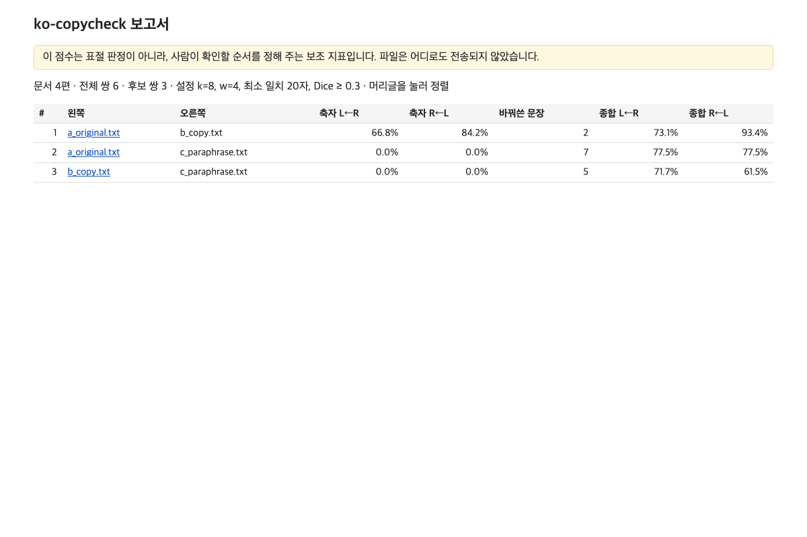
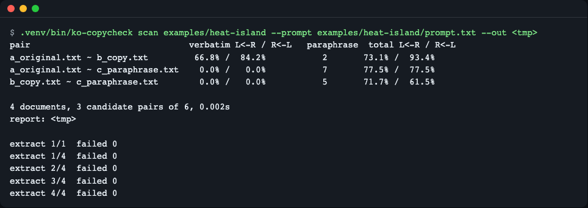
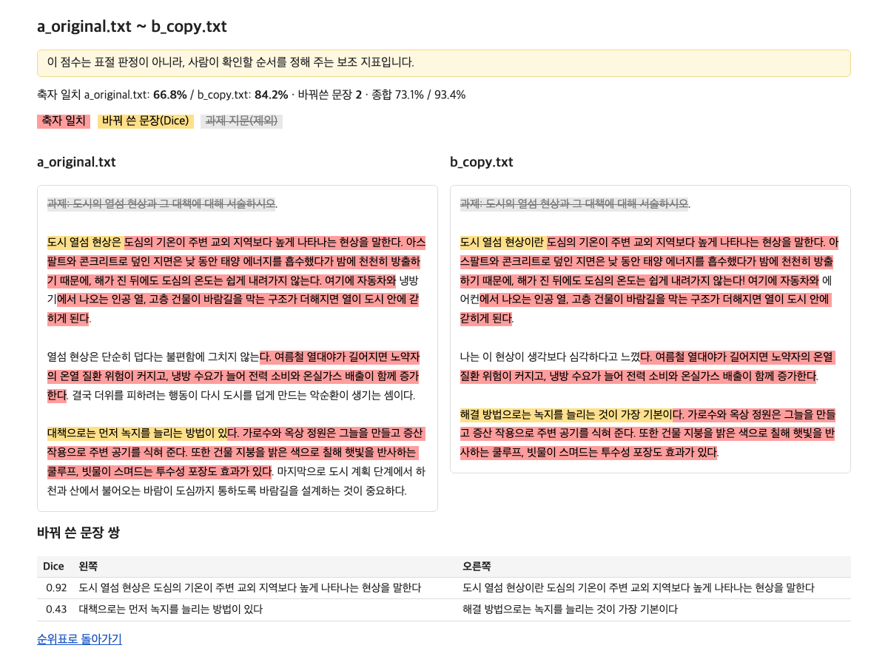
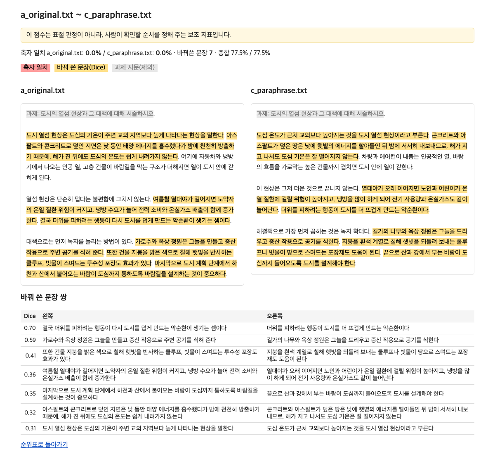
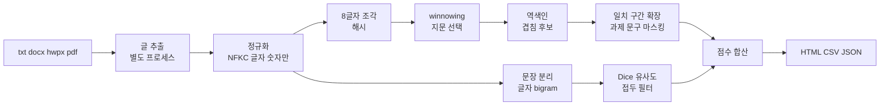

# ko-copycheck

> **English summary** — An offline plagiarism checker for Korean prose submissions. Point it at a folder of txt, docx, hwpx and pdf files and it writes a ranked table of "who overlaps with whom" plus side-by-side HTML pages; nothing is uploaded. It combines winnowing (verbatim copies) with sentence character-bigram Dice similarity (paraphrases), and it ignores the assignment prompt and passages most students quote. Install: `uv tool install git+https://github.com/LeeGyeongPil/ko-copycheck`, run: `ko-copycheck scan <folder> --prompt prompt.txt`. The score is a hint for where a human should look, not a verdict.

과제 제출물 폴더를 한 번에 서로 비교해 **"누가 누구와 얼마나 겹치나"** 순위표와, 의심 쌍을 나란히 보여 주는 HTML 보고서를 만드는 오프라인 도구입니다. 파일은 어디로도 전송되지 않습니다.


*`scan` 결과의 index.html. 겹침이 큰 쌍부터 줄이 나열되고, 이름을 누르면 나란히 보기가 열립니다.*

## 이런 분께
- 한 반의 글쓰기 과제(수십~수백 편)를 받아 채점 전에 겹치는 쌍을 먼저 추리고 싶은 강사·조교
- 학생 글을 외부 서비스에 올리기 어려워서(개인정보·유료 한도) 내 컴퓨터에서만 돌리고 싶은 분
- 제출물이 txt·docx·hwpx·pdf로 섞여 있어서 코드용 표절 검사 도구를 쓰기 번거로웠던 분

이 도구는 **사람이 확인할 순서를 정해 주는 보조 지표**입니다. 점수가 높다고 표절이 확정되지는 않습니다.

## 설치
전제: Python 3.11 이상, [uv](https://docs.astral.sh/uv/).
```bash
curl -LsSf https://astral.sh/uv/install.sh | sh      # uv 설치(이미 있으면 생략)
uv tool install git+https://github.com/LeeGyeongPil/ko-copycheck
```
설치 없이 한 번만 돌려 보려면 저장소를 받아 실행합니다(아래 예제 폴더가 들어 있습니다).
```bash
git clone https://github.com/LeeGyeongPil/ko-copycheck && cd ko-copycheck
uv sync
```
설치 뒤 `ko-copycheck` 명령을 찾지 못하면(`not on your PATH` 경고) `uv tool update-shell`을 실행하고 새 터미널을 여세요.

최소 리눅스 컨테이너에는 `curl`과 `git`만 있으면 됩니다. 의존성은 python-docx 1.2.0, pypdf 7.0.0 두 개뿐입니다.

## 빠르게 시작하기
저장소 안의 `examples/heat-island/`는 직접 쓴 짧은 예제입니다. 원본(a), 거의 그대로 베낀 글(b), 같은 내용을 바꿔 쓴 글(c), 주제가 다른 글(d)과 과제 문구(prompt.txt)가 들어 있습니다.

```bash
uv run ko-copycheck scan examples/heat-island --prompt examples/heat-island/prompt.txt --out report
```
```text
pair                               verbatim L<-R / R<-L   paraphrase  total L<-R / R<-L
a_original.txt ~ b_copy.txt         66.8% /  84.2%           2       73.1% /  93.4%
a_original.txt ~ c_paraphrase.txt    0.0% /   0.0%           7       77.5% /  77.5%
b_copy.txt ~ c_paraphrase.txt        0.0% /   0.0%           5       71.7% /  61.5%

4 documents, 3 candidate pairs of 6, 0.003s
report: report/index.html
```
(진행 표시 `extract 1/4  failed 0`는 stderr로 따로 나옵니다. `candidate pairs`는 표에 나온 쌍 수, 곧 축자 또는 바꿔 쓴 문장 층에 걸린 쌍 수입니다.)


*터미널 요약(그림은 설치된 `ko-copycheck`로 찍어 마지막 줄의 보고서 경로만 임시 폴더로 보입니다). 같은 표가 `report/index.html`, `pairs.csv`, `pairs.json`에도 저장됩니다.*

읽는 법:
- **verbatim L<-R**: 왼쪽 글의 몇 %가 오른쪽 글에서 그대로(스무 글자 이상 이어서) 나왔는가. `R<-L`은 반대 방향입니다. 짧은 글이 긴 글에 통째로 들어 있으면 두 값이 다릅니다.
- **paraphrase**: 표현은 달라도 문장 단위로 비슷한 문장 쌍의 개수.
- **total**: 축자 일치와 바꿔 쓴 문장이 덮는 글자 비율을 합친 값(겹치는 글자는 한 번만 셉니다).
- a와 b는 복사라서 축자 일치가 높고, a와 c는 축자 일치가 0%인데 바꿔 쓴 문장이 7개로 잡혔습니다. d는 다른 글과 겹치지 않아 표에 나오지 않습니다(CSV·JSON에는 0점으로 있습니다).
- 과제 문구(`과제: 도시의 열섬 현상과 …`)는 모두가 인용하므로 `--prompt`로 알려 주면 점수 계산에서 빠집니다.

의심 쌍 하나를 열어 보면 겹친 곳이 색으로 표시됩니다.


*a_original(왼쪽)과 b_copy(오른쪽). 붉은 칠은 그대로 일치, 노란 칠은 바꿔 쓴 문장, 회색 취소선은 과제 문구(제외)입니다.*


*a_original과 c_paraphrase. 글자가 거의 같지 않아도 문장 단위로 옅게 표시됩니다. 마우스를 올리면 Dice 값이 나옵니다.*

## 사용법
| 명령·옵션 | 하는 일 | 예 |
|---|---|---|
| `scan <폴더>` | 폴더의 모든 파일 쌍을 비교하고 보고서를 씀 | `ko-copycheck scan submissions --out report` |
| `pair <왼쪽> <오른쪽>` | 두 파일만 비교해 HTML 한 장을 씀(`--out`은 파일 경로) | `ko-copycheck pair a.hwpx b.docx --out pair.html` |
| `extract <파일>` | 파일에서 뽑은 글을 출력(읽기가 제대로 되는지 확인) | `ko-copycheck extract a.hwpx` |
| `--prompt FILE` | 과제 문구 파일. 여러 번 쓸 수 있음. 이 파일은 비교 대상에서도 빠짐 | `--prompt prompt.txt` |
| `--dice` | 바꿔 쓴 문장 판정 기준(기본 0.3) | `--dice 0.2` |
| `--min-match` | 그대로 일치로 세는 최소 글자 수(기본 20) | `--min-match 40` |
| `--min-sentence` | 바꿔 쓰기 비교에 쓰는 최소 문장 길이(정규화 글자, 기본 10) | `--min-sentence 15` |
| `--k`, `--w` | k-gram 길이(8), 윈도 크기(4) | `--k 8 --w 4` |
| `--group-ratio` | 이 비율 이상의 문서가 공유한 구절은 "공통"으로 제외(기본 0.5, 3편 이상일 때) | `--group-ratio 0.4` |
| `--recursive` | 하위 폴더도 읽음 | |
| `--top N` | 나란히 보기 페이지를 최대 N쌍만 만듦(기본 300) | |
| `--timeout` | 파일 하나를 읽는 제한 시간(초, 기본 60) | |

시나리오:
1. **제출물이 섞인 폴더 한 번에 보기** — `scan submissions --prompt prompt.txt` → 콘솔에 상위 쌍과 `report/index.html`이 나옵니다 → 표의 머리글을 눌러 정렬하고, 위쪽 쌍부터 나란히 보기로 확인합니다.
2. **파일이 제대로 읽히는지 의심될 때** — `extract 파일` → 뽑힌 글이 그대로 출력됩니다. 글이 비어 있으면 스캔 PDF 같은 그림 파일일 가능성이 큽니다.
3. **두 편만 급히 대 보기** — `pair a.docx b.hwpx --out pair.html`.

## 설정
설정 파일이나 환경변수, API 키는 없습니다. 모든 값은 위 옵션이며 기본값은 `src/ko_copycheck/config.py`에 있습니다. 네트워크 연결을 쓰지 않으므로 "연습용 목(mock) 모드" 같은 것도 없습니다. 항상 실제 계산입니다.

## 동작 원리

1. 글 추출: 깨진 파일이나 폭탄 같은 파일이 전체를 멈추지 않도록 별도 프로세스에서 읽습니다. 상한은 파일 50MB, 압축 해제 합계 200MB, zip 항목 5000개, 파일당 60초(`--timeout`)이고, 리눅스에서는 메모리 2GB도 감시합니다. 읽지 못했거나 글이 거의 없는 파일(빈 파일 등)은 `FAILED` 행으로 남기고 나머지는 계속 비교합니다.
2. 정규화: 유니코드를 NFKC로 통일하고 글자·숫자만 남겨 띄어쓰기·문장부호 차이를 없앱니다.
3. 8글자 조각 해시: 모든 연속 8글자를 해시합니다. 어절이 아니라 글자 단위인 이유는 조사 하나("지역이"/"지역보다")에 어절이 달라지기 때문입니다.
4. winnowing: 네 개짜리 창마다 가장 작은 해시를 골라 지문으로 삼습니다. 두 글이 11글자 이상 같으면 반드시 같은 지문을 하나는 고릅니다.
5. 역색인과 확장: 같은 지문을 가진 문서 쌍을 찾아 앞뒤로 글자 단위로 넓혀 20자 이상 일치 구간을 만듭니다. 과제 문구와 대다수가 공유한 구절은 제외합니다.
6. 바꿔 쓴 문장: 문장마다 글자 2개짜리 조각(bigram) 집합을 만들어 Dice 계수로 비교합니다. 비교 쌍이 너무 많아지지 않게 드문 bigram을 공유하는 문장만 비교합니다.
7. 점수와 보고서: 두 층이 덮는 글자 비율을 합산해 표와 나란히 보기를 만듭니다.

자세한 설명과 작은 계산 예는 [docs/algorithm.md](docs/algorithm.md).

## 코드 둘러보기
- `src/ko_copycheck/winnow.py` — `kgram_hashes`와 `winnow`. 해시는 blake2b 8바이트라 프로세스마다 같습니다(내장 `hash()`는 실행마다 달라집니다).
- `src/ko_copycheck/paraphrase.py` — `bigram_set`, `dice`, `matches_prefix`(전수 비교와 같은 결과를 내는 접두 필터).
- `src/ko_copycheck/verbatim.py` — 역색인에서 후보를 찾고 일치 구간을 넓히고 과제 문구를 마스킹.

## 언제 쓰나
- 한국어 산문 과제 제출물(txt·docx·hwpx·pdf)끼리 겹치는 쌍을 오프라인으로 먼저 추릴 때 쓰세요.
- 코드 과제라면 [Dolos](https://dolos.ugent.be/)나 [JPlag](https://github.com/jplag/JPlag)를 살펴보세요.
- 인터넷·논문 DB와의 대조가 필요하면 업로드형 표절 검사 서비스를 쓰세요. 이 도구는 제출물끼리만 비교하며 인터넷 자료와는 비교하지 못합니다.

## 한계 (솔직하게)
- **Dice 기본값 0.30은 작은 직접 쓴 보정 데이터에서 정한 출발점**입니다. 같은 주제의 무관한 글 최고 0.14에 여유 0.15를 더한 값인데, 같은 데이터에서 바꿔 쓴 25문장 중 **12개만** 잡습니다. 즉 놓치는 것이 많습니다. `--dice 0.2`로 낮추면 더 잡지만 오탐도 늘 수 있으니 자기 반 글로 직접 조정하세요. `uv run python scripts/calibrate.py`로 보정 과정을 재현할 수 있습니다.
- **hwpx·pdf는 이 저장소가 만든 테스트용 파일로만 확인**했습니다. 실제 한컴오피스 hwpx, 실제 학생 docx, 한글 pdf로는 검증하지 못했습니다. 읽기가 의심되면 `extract`로 먼저 확인하세요. 스캔 이미지 PDF는 글이 없어 읽지 못합니다.
- 3편 이상이 절반 넘게 공유한 구절은 "공통"으로 보고 제외하므로, 여럿이 함께 베낀 진짜 집단 복사는 점수에서 빠집니다.
- macOS에서는 추출 프로세스의 메모리 상한을 걸지 못하고 시간·크기 제한으로만 막습니다.
- 점수는 표절 판정이 아닙니다. 인용 표시가 있는 글도 겹침으로 나옵니다.

## 로드맵
- **M2 운영 편의**: 지문 캐시, `--against`(참고 자료 폴더와 비교), 3명 이상이 겹치는 무리 보기, 보정 데이터 확대.
- **M3 선택 기능**: `[hwp]`(옛 hwp 읽기, 의존성 pyhwp가 AGPL-3.0+라 라이선스 주의), `[embed]`(로컬 임베딩 의미 유사도, 기본 꺼짐).

아직 구현되지 않았습니다. 지금 버전(0.1.1)은 M1입니다.

## 자주 겪는 문제
| 증상 | 원인 | 해결 |
|---|---|---|
| `error: fewer than 2 files could be read` 와 `corrupt: not a valid zip container` | docx가 깨졌거나 확장자만 docx | 파일을 다시 받거나 `extract`로 확인 |
| 과제 문구 파일이 표에 문서로 나오고 모두와 겹쳐 보임 | `--prompt` 없이 `prompt.txt`가 폴더에 있음 | `--prompt prompt.txt`로 지정(비교 대상에서 빠짐) |
| 바꿔 쓴 글이 안 잡힘 | `--dice` 기준이 높음 | `--dice 0.2`부터 시도 |
| 모두가 조금씩 겹쳐 보임 | 같은 과제 지문을 다들 인용 | 과제 문구를 `--prompt`로 지정 |
| `no_text` 실패 행 | 빈 파일이거나 글자가 8자 미만 | 파일 내용을 확인 |
| 글이 비어 나옴 | 스캔 이미지 PDF | OCR이 된 파일로 바꿔 제출받기 |

## 개발·기여
```bash
uv run pytest -q   # 33 passed
```
버그·제안은 이슈로 남겨 주세요. 변경 기록은 [CHANGELOG.md](CHANGELOG.md).

## 직접 바꿔 보기
1. **기준 낮추기** — `scan … --dice 0.2` 로 다시 실행합니다. 바꿔 쓴 문장 수가 7→10(a~c), 5→7(b~c)로 늘어납니다. 반대로 `--dice 0.5`면 a~c가 2개, 종합 16.2%로 줄어 바꿔 쓴 글을 거의 놓칩니다.
2. **`--prompt` 빼기** — 같은 폴더를 `--prompt` 없이 돌리면 `prompt.txt`가 문서로 세어져 `d_unrelated.txt ~ prompt.txt` 같은 쌍이 100%로 위에 올라옵니다.
3. **최소 일치 늘리기** — `--min-match 40`이면 a~b 축자 일치가 66.8%→57.2%로 줄어듭니다(짧은 일치 조각이 버려지므로).

## 라이선스
MIT.
